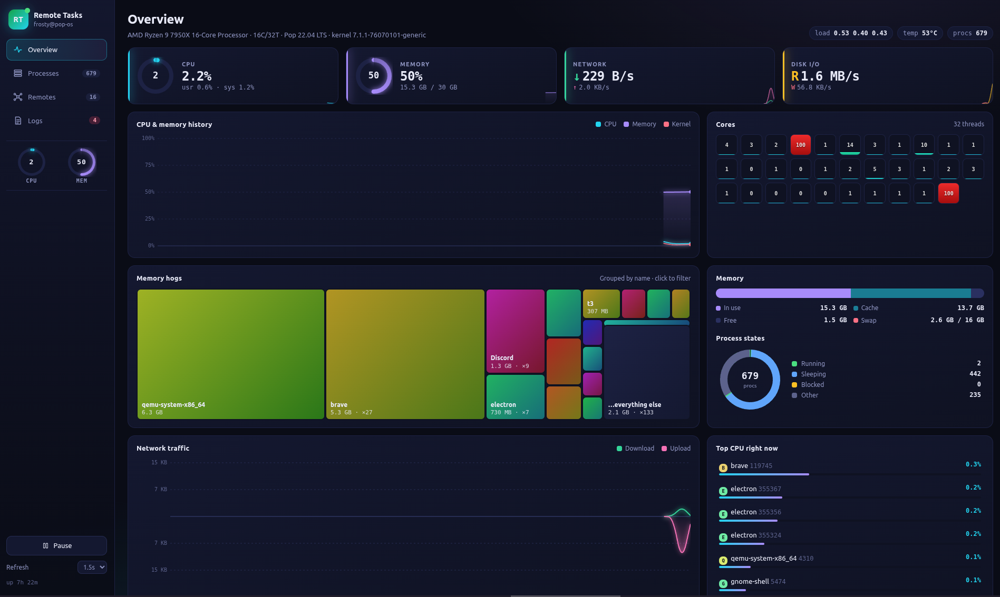
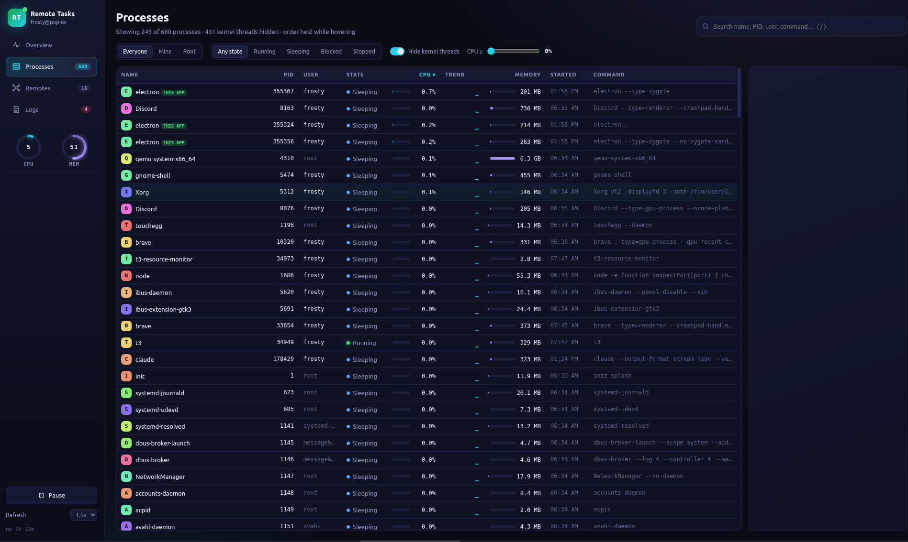
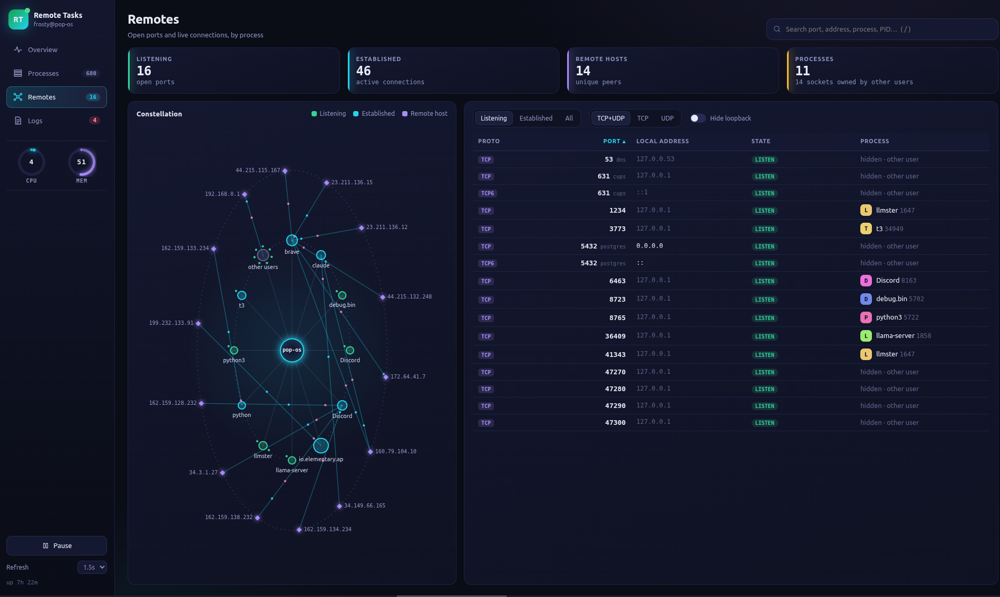
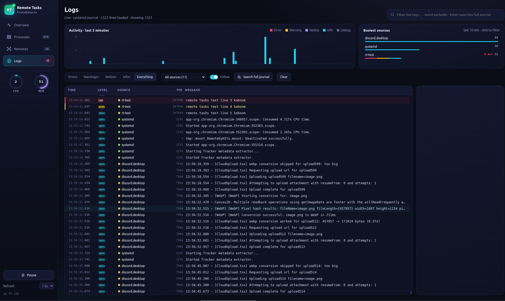

# Remote Tasks

A visual task manager for the Linux desktop: live system graphs, a searchable process list, open ports and connections, and the system journal, all in one window. Right-click any process to kill it.

Built with Electron and [systeminformation](https://systeminformation.io).



## Download

Get the AppImage from the [latest release](https://github.com/hazlema/linux-gui-taskman/releases/latest), then:

```sh
chmod +x Remote-Tasks-*-x86_64.AppImage
./Remote-Tasks-*-x86_64.AppImage
```

AppImages need FUSE. If it won't start on Ubuntu 22.04 or newer, install it with `sudo apt install libfuse2`.

### Tested on

- Pop!_OS 22.04 LTS (x86_64), GNOME 42.9 on X11
- Linux kernel 7.1.1, systemd 249, glibc 2.35

It should work on any recent x86_64 distro with systemd. Reports from other distros are welcome.

### Run from source

```sh
npm install
npm start
```

To build the AppImage yourself, run `npm run dist`. It writes `dist/Remote-Tasks-<version>-x86_64.AppImage`.

## Screenshots

| Processes | Remotes |
| --- | --- |
|  |  |



## Tabs

- **Overview**: CPU and memory rings, live history charts, a per-core heat grid, a treemap of the biggest memory users (click a tile to filter, right-click it to end every process with that name), memory breakdown, process-state donut, network traffic and top CPU users.
- **Processes**: a sortable table with search (space-separated terms are ANDed; `:8080` finds whoever is using port 8080), filters for owner, state, kernel threads and minimum CPU, and a per-process CPU trend. Click a row for a detail panel with its CPU and memory history, parent, children, sockets and full command line. Rows stop reordering while your pointer is over the table, so they don't move away before you right-click.
- **Remotes**: listening ports and live connections. Filter by state and protocol, or hide loopback. The constellation graph shows processes around your host and the remote peers they talk to. Hover a node for details, click it to filter the table, right-click a process node to kill it.
- **Logs**: the system journal, live. Search as you type (space-separated terms are ANDed, `-word` excludes), filter by level or source, and see activity per second for the last 2 minutes plus the busiest sources. Press Enter (or **Search full journal**) to search everything stored on disk, not just the lines loaded in the app. Scrolling up pauses the auto-scroll. Click a line for details, or right-click to copy it, jump to the lines around it, or end the process that wrote it. The Logs badge counts errors from the last 5 minutes. On systems without journalctl it follows `/var/log/syslog` instead.

## Killing processes

Right-click any process (in the table, the top-CPU list, the constellation, or a socket row) to:

- **End process**: sends SIGTERM.
- **Force kill**: sends SIGKILL, after a confirmation.
- **Kill process tree**: ends the process and all its descendants.
- **End all with this name**: ends every process with the same name.
- **Suspend / Resume**: sends SIGSTOP / SIGCONT.

You can also copy a PID, a command line or an address from the same menu.

Without root you can only signal your own processes. Sockets owned by other users show as "hidden · other user" because Linux won't reveal their PIDs to you. To see everything, run with `sudo -E npm start -- --no-sandbox`. Seeing all system logs needs membership in the `adm` or `systemd-journal` group; otherwise you only see your own.

## Keys

| Key | Action |
| --- | --- |
| `Ctrl+1/2/3/4` | Switch tab |
| `/` | Focus search |
| `Space` | Pause / resume updates |
| `↑ / ↓` | Move selection |
| `Del` / `Shift+Del` | End / force kill selected process |
| `Esc` | Close menu or panel |
